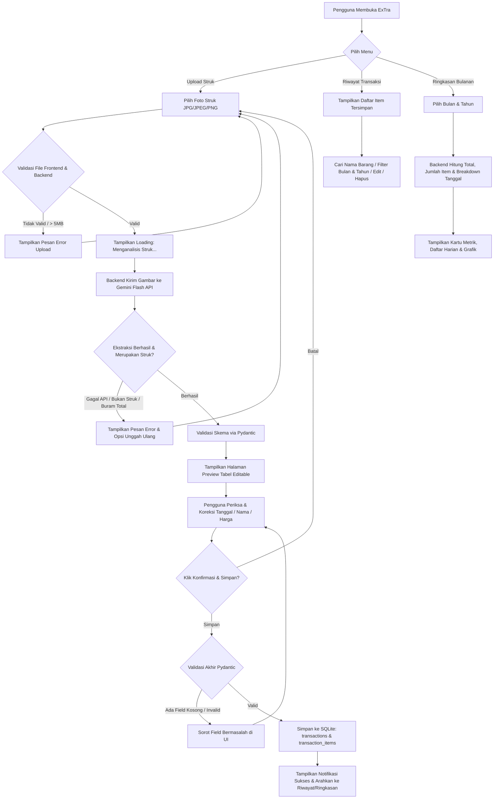
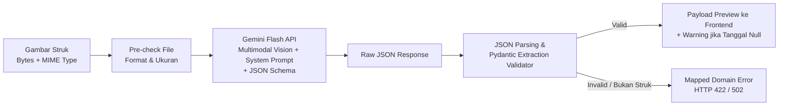
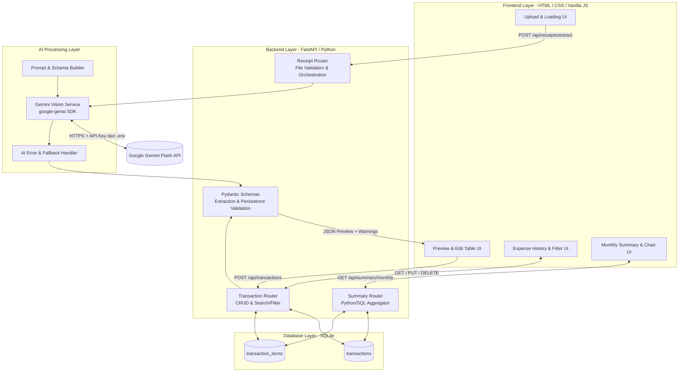
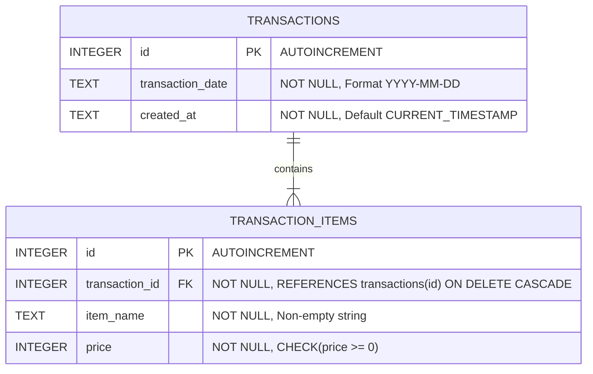

# Product Requirements Document (PRD): ExTra (Expense Tracker)

| Atribut Dokumen | Detail |
| :--- | :--- |
| **Nama Produk** | ExTra (Expense Tracker) |
| **Versi Dokumen** | 1.0 (MVP Specification) |
| **Tipe Aplikasi** | AI-Powered Web Application |
| **Tanggal Penyusunan** | 24 November 2026 |
| **Status** | Draft Final — Siap untuk Implementasi di Google Antigravity |
| **Tujuan Dokumen** | Pedoman tunggal (Single Source of Truth) arsitektur, kontrak data, batasan fitur, dan roadmap pengembangan MVP |

---

## 1. Product Overview

**ExTra (Expense Tracker)** adalah aplikasi pencatatan dan pemantauan pengeluaran pribadi berbasis web yang memanfaatkan **Multimodal AI (Vision)** untuk mengotomatisasi konversi foto struk belanja fisik menjadi catatan transaksi digital terstruktur.

Alur kerja inti aplikasi menempatkan AI sebagai asisten ekstraksi dan pengguna sebagai pengambil keputusan akhir (*human-in-the-loop*):
1. Pengguna mengunggah foto struk belanja melalui antarmuka web.
2. Backend mengirimkan gambar ke **Google Gemini Flash API** untuk mengekstrak tiga informasi inti: **nama barang**, **harga per barang**, dan **tanggal transaksi**.
3. Hasil ekstraksi divalidasi secara skema menggunakan **Pydantic**, lalu ditampilkan pada halaman pratinjau (*preview*) agar pengguna dapat memeriksa dan mengoreksi kesalahan sebelum disimpan ke database **SQLite**.
4. Data tersimpan digunakan untuk menampilkan **riwayat transaksi** serta **ringkasan pengeluaran bulanan** yang seluruh perhitungannya dilakukan secara deterministik oleh backend Python.

---

## 2. Problem Statement

* **Beban Pencatatan Manual Tinggi:** Mencatat pengeluaran harian menuntut pengguna mengetik nama barang, harga, dan tanggal transaksi satu per satu. Proses yang repetitif ini menyebabkan pengguna cepat berhenti mencatat pengeluaran secara konsisten.
* **Data Struk Fisik Tidak Terpakai:** Struk belanja sebenarnya sudah memuat detail transaksi yang lengkap, namun umumnya hanya disimpan sementara lalu dibuang tanpa pernah direkap untuk evaluasi bulanan.
* **Ketidakandalan Otomatisasi Penuh:** Mengandalkan AI untuk langsung menyimpan data ke database tanpa verifikasi berisiko menghasilkan data keuangan yang keliru akibat struk buram, kusut, atau salah baca angka.

**Solusi ExTra:** Menyederhanakan input data dengan ekstraksi struk otomatis berbasis Gemini Vision, digabungkan dengan validasi skema ketat (Pydantic) dan tahap konfirmasi pengguna agar data pengeluaran tetap akurat dengan usaha input minimal.

---

## 3. Product Goals & Objectives

| Kategori | Objektif | Indikator Keberhasilan (Target MVP) |
| :--- | :--- | :--- |
| **Efisiensi Input** | Memangkas waktu pencatatan struk belanja dibanding input manual. | Waktu dari upload foto hingga data tersimpan di database kurang dari 30 detik untuk struk berisi 5–10 barang. |
| **Integritas Data** | Menjamin tidak ada data transaksi invalid yang masuk ke database. | 100% data tersimpan lolos validasi Pydantic dan melewati konfirmasi manual pengguna. |
| **Akurasi Perhitungan** | Menghilangkan risiko halusinasi AI dalam kalkulasi angka keuangan. | 100% perhitungan total bulanan, jumlah item, dan agregasi per tanggal dilakukan di backend Python/SQL, bukan LLM. |
| **Kesiapan Arsitektur** | Membangun fondasi kode modular untuk pembelajaran AI Engineering. | Pemisahan tanggung jawab jelas antara Frontend, Backend API, AI Processing Layer, dan Database tanpa library berlebihan. |

---

## 4. Target Users & User Personas

Aplikasi MVP ini dirancang untuk penggunaan tunggal (personal/lokal) dengan tiga segmen utama: individu yang ingin mencatat pengeluaran harian, mahasiswa yang memantau anggaran bulanan, serta pengguna yang menginginkan rekap belanja tanpa input manual.

### Persona 1: Mahasiswa Pengelola Uang Saku
* **Profil:** Raka, 20 tahun, mahasiswa kos dengan jatah uang bulanan tetap.
* **Tujuan:** Mengetahui total pengeluaran bulanan untuk kebutuhan harian (makanan, minuman, perlengkapan kos) agar uang tidak habis sebelum akhir bulan.
* **Pain Points:** Sering lupa mencatat pembelian kecil di minimarket karena malas mengetik setiap item satu per satu.
* **Skenario Penggunaan:** Setelah belanja di minimarket, Raka memotret struk dengan ponsel, mengunggahnya ke ExTra, memeriksa cepat harga barang di tabel preview, lalu klik simpan.

### Persona 2: Pekerja Muda Pencatat Pengeluaran Pribadi
* **Profil:** Dina, 25 tahun, staf junior yang mulai membangun kebiasaan evaluasi keuangan pribadi setiap akhir bulan.
* **Tujuan:** Memiliki riwayat belanja yang rapi, mudah dicari berdasarkan nama barang, dan menyajikan grafik pengeluaran bulanan.
* **Pain Points:** Kertas struk sering pudar atau hilang sebelum sempat direkap ke catatan manual di akhir pekan.
* **Skenario Penggunaan:** Dina mengunggah beberapa struk belanja mingguan ke ExTra dan membuka halaman ringkasan bulanan di akhir bulan untuk mengevaluasi tanggal dengan pengeluaran tertinggi.

---

## 5. User Stories

| ID | Sebagai... | Saya ingin... | Agar... | Modul Terkait |
| :--- | :--- | :--- | :--- | :--- |
| **US-01** | Pengguna | Mengunggah foto struk belanja berformat JPG, JPEG, atau PNG | Saya tidak perlu mengetik daftar belanjaan secara manual | Receipt Upload |
| **US-02** | Pengguna | Melihat indikator status saat struk sedang diproses AI | Saya tahu sistem sedang bekerja dan tidak menekan tombol berulang kali | Receipt Upload |
| **US-03** | Pengguna | Sistem otomatis mengekstrak nama barang, harga per barang, dan tanggal transaksi dari foto struk | Seluruh item belanja langsung tersedia dalam bentuk data digital | AI Receipt Extraction |
| **US-04** | Pengguna | Memeriksa dan mengedit hasil ekstraksi AI dalam tabel sebelum disimpan | Kesalahan pembacaan AI dapat saya perbaiki sebelum masuk ke riwayat | Data Validation & Preview |
| **US-05** | Pengguna | Mengonfirmasi secara eksplisit sebelum data disimpan | Tidak ada data yang tersimpan secara tidak sengaja | Data Validation & Preview |
| **US-06** | Pengguna | Melihat daftar seluruh transaksi tersimpan serta mencari nama barang tertentu | Saya dapat melacak kapan dan berapa harga barang yang pernah dibeli | Expense History |
| **US-07** | Pengguna | Memfilter riwayat transaksi berdasarkan bulan dan tahun | Saya dapat fokus melihat pengeluaran pada periode tertentu | Expense History |
| **US-08** | Pengguna | Mengedit atau menghapus catatan transaksi yang sudah tersimpan | Riwayat pengeluaran tetap akurat apabila ada koreksi di kemudian hari | Expense History |
| **US-09** | Pengguna | Melihat total pengeluaran bulanan, jumlah barang, daftar per tanggal, dan grafik sederhana | Saya dapat mengevaluasi pola pengeluaran bulanan secara cepat | Monthly Expense Summary |

---

## 6. Functional Requirements

### A. Receipt Upload
* **FR-01:** Sistem menyediakan antarmuka unggah gambar struk (file picker dan/atau drag-and-drop) dengan pratinjau gambar (*thumbnail preview*) sebelum dikirim.
* **FR-02:** Sistem hanya menerima file gambar dengan ekstensi dan MIME type yang valid: `JPG`, `JPEG`, dan `PNG`.
* **FR-03:** Sistem memvalidasi ukuran file di sisi frontend dan backend (batas maksimal **5 MB** per file untuk menjaga kecepatan upload dan pemrosesan API).
* **FR-04:** Sistem menampilkan status pemrosesan yang jelas (*uploading / analyzing receipt*) serta menonaktifkan tombol submit selama proses berjalan untuk mencegah duplikasi request.

### B. AI Receipt Extraction
* **FR-05:** Backend mengirimkan gambar struk tervalidasi ke **Google Gemini Flash API** dengan instruksi ekstraksi multimodal vision.
* **FR-06:** AI mengekstrak seluruh item belanja yang tertera pada struk dengan cakupan data **dibatasi ketat** hanya pada:
  1. `date`: Tanggal transaksi pada struk (format `YYYY-MM-DD`).
  2. `items[].name`: Nama masing-masing barang.
  3. `items[].price`: Harga masing-masing barang dalam angka numerik.
* **FR-07:** AI **dilarang** mengekstrak atau menyertakan nama toko, alamat toko, nomor telepon, metode pembayaran, kasir, kembalian, atau informasi lain di luar skema.
* **FR-08:** Output AI wajib mengikuti kontrak JSON terstruktur berikut:

```json
{
  "date": "2026-11-24",
  "items": [
    {
      "name": "Indomie Goreng",
      "price": 3500
    },
    {
      "name": "Aqua 600ml",
      "price": 4000
    },
    {
      "name": "Roti Coklat",
      "price": 8500
    }
  ]
}
```

### C. Data Validation & Preview
* **FR-09:** Seluruh hasil JSON dari Gemini API wajib divalidasi oleh **Pydantic** di backend sebelum dikirim ke frontend, serta divalidasi ulang oleh Pydantic sebelum disimpan ke SQLite.
* **FR-10:** Aturan validasi data (ketika menyimpan ke database):
  * `date`: wajib ada dan memenuhi format valid `YYYY-MM-DD`.
  * `items`: daftar barang minimal berisi 1 item.
  * `name`: bertipe string, tidak kosong setelah trim spasi (*whitespace*).
  * `price`: bertipe numerik (integer), tidak bernilai negatif (minimal `0`).
* **FR-11:** Frontend menampilkan hasil ekstraksi dalam bentuk tabel interaktif (*editable table*) berisi input tanggal transaksi serta baris daftar barang (nama barang dan harga).
* **FR-12:** Pengguna dapat mengubah nama barang, mengubah harga, mengubah tanggal transaksi, menghapus baris item yang salah baca, atau menambah baris item yang terlewat oleh AI.
* **FR-13:** Data **tidak boleh** tersimpan otomatis setelah ekstraksi selesai; penyimpanan ke database hanya terjadi setelah pengguna menekan tombol **Konfirmasi & Simpan**.

### D. Expense History
* **FR-14:** Sistem menampilkan daftar seluruh catatan barang dari transaksi yang telah tersimpan, memuat kolom: **Tanggal Transaksi**, **Nama Barang**, dan **Harga**, diurutkan default dari tanggal terbaru.
* **FR-15:** Sistem menyediakan kotak pencarian (*search bar*) yang memfilter riwayat berdasarkan kecocokan sebagian (*case-insensitive substring*) pada **nama barang**.
* **FR-16:** Sistem menyediakan filter periode berdasarkan **Bulan** (Januari–Desember) dan **Tahun**.
* **FR-17:** Pengguna dapat mengedit detail item/transaksi (nama barang, harga, tanggal) maupun menghapus item atau keseluruhan transaksi dengan dialog konfirmasi penghapusan.

### E. Monthly Expense Summary
* **FR-18:** Pengguna dapat memilih periode **Bulan** dan **Tahun** (default: bulan dan tahun berjalan).
* **FR-19:** Backend Python/SQL menghitung dan mengembalikan metrik berikut secara deterministik (bukan menggunakan LLM):
  * **Total Pengeluaran Bulanan** (penjumlahan seluruh harga barang pada periode terpilih).
  * **Jumlah Barang Tercatat** (total baris item pada periode terpilih).
  * **Daftar Pengeluaran per Tanggal** (agregasi subtotal harian untuk setiap tanggal yang memiliki transaksi pada periode terpilih).
* **FR-20:** Frontend menampilkan ringkasan dalam bentuk kartu metrik (*summary cards*), daftar pengeluaran per tanggal, serta satu **grafik sederhana** (misalnya *bar chart* pengeluaran per tanggal dalam bulan terpilih menggunakan Canvas/SVG sederhana atau library ringan seperti Chart.js via CDN).

---

## 7. Non-Functional Requirements

| ID | Kategori | Kebutuhan Spesifik | Kriteria Pengukuran |
| :--- | :--- | :--- | :--- |
| **NFR-01** | **Usability** | Antarmuka bersih, responsif untuk layar desktop/mobile, dengan alur navigasi maksimal 3 halaman/tab utama (Upload & Preview, Riwayat, Ringkasan Bulanan). | Pengguna baru dapat menyelesaikan alur upload hingga simpan tanpa panduan tambahan. |
| **NFR-02** | **Performance** | Endpoint lokal (riwayat, CRUD, summary) merespons cepat; proses ekstraksi AI memiliki umpan balik status yang informatif. | Operasi CRUD & Summary di bawah 300 ms; proses ekstraksi AI memiliki timeout backend 30 detik dengan indikator loading aktif. |
| **NFR-03** | **Reliability** | Sistem tidak crash ketika Gemini API gagal, timeout, atau mengembalikan format tak terduga. | Seluruh error pihak ketiga ditangkap (*caught*) dan dikembalikan sebagai pesan error JSON terstruktur yang ramah pengguna. |
| **NFR-04** | **Data Integrity** | Tidak ada data korup, harga negatif, nama kosong, atau item yatim (*orphan record*) di database. | Validasi Pydantic aktif di setiap endpoint tulis; SQLite mengaktifkan `PRAGMA foreign_keys = ON` dan constraint `CHECK`. |
| **NFR-05** | **Security** | Kredensial Gemini API Key disimpan exclusively di file `.env` pada sisi server dan masuk daftar `.gitignore`. | Zero hardcoded API key di kode backend, kode frontend (HTML/JS), maupun riwayat commit Git. File upload divalidasi konten/MIME-nya, bukan sekadar ekstensi nama file. |
| **NFR-06** | **Maintainability** | Struktur kode modular dengan pemisahan layer (routes, services, schemas, database, prompts). | Perubahan pada prompt AI atau tampilan frontend tidak memerlukan modifikasi pada skema database atau kalkulasi summary. |

---

## 8. MVP Scope & Out of Scope

| In-Scope (MVP v1.0) | Out of Scope (Tidak Dibangun di MVP) | Alasan Pengecualian |
| :--- | :--- | :--- |
| Pencatatan pengeluaran pribadi (single-user lokal) | Multi-user, registrasi, login, dan autentikasi kompleks | Menambah kompleksitas sesi, JWT, dan keamanan password di luar fokus inti AI Engineering. |
| Upload foto struk (JPG, JPEG, PNG) | Integrasi rekening bank / e-wallet & sinkronisasi otomatis | Memerlukan API perbankan/agregator berbayar dan kepatuhan regulasi keamanan finansial. |
| Ekstraksi 3 field: nama barang, harga, tanggal | Ekstraksi nama toko, alamat, metode bayar, atau pajak terpisah | Tidak dibutuhkan oleh requirement utama; menyederhanakan prompt & akurasi ekstraksi. |
| Validasi Pydantic + Preview & Edit manual | Kategorisasi pengeluaran otomatis oleh AI | Memerlukan taksonomi kategori tambahan dan memperbesar ruang kesalahan klasifikasi di MVP. |
| Riwayat transaksi (list, search, filter bulan/tahun, edit, delete) | Pencatatan pemasukan (*income tracking*) & manajemen saldo | Fokus MVP adalah pemantauan pengeluaran berbasis struk belanja. |
| Ringkasan bulanan & grafik sederhana (kalkulasi backend) | Rekomendasi finansial berbasis AI & prediksi pengeluaran | Membutuhkan histori data jangka panjang dan menambah ruang lingkup prompt analitik. |
| Penyimpanan lokal SQLite | Integrasi Google Sheets / ekspor cloud eksternal | SQLite sudah mencukupi kebutuhan CRUD & agregasi tanpa ketergantungan OAuth tambahan. |

---

## 9. User Flow



---

## 10. AI Workflow

### Pipeline Pemrosesan AI



### 5 Pilar Implementasi AI

1. **Multimodal AI (Vision):**
   * Menggunakan SDK resmi Python `google-genai` dengan model kelas **Google Gemini Flash** untuk keseimbangan kecepatan respons, biaya rendah, dan akurasi OCR/vision pada struk belanja.
   * Gambar dikirim sebagai *inline image bytes* bersama MIME type (`image/jpeg` atau `image/png`) tanpa menyimpan file gambar permanen ke disk.

2. **Prompt Engineering (Ketat & Deterministik):**
   * Prompt dipisahkan dalam modul khusus (`prompts.py`).
   * **Aturan wajib dalam System Instruction:**
     * Periksa terlebih dahulu apakah gambar merupakan struk belanja yang dapat dibaca. Jika bukan struk atau terlalu buram, tandai `is_receipt: false`.
     * Ekstrak **hanya** tanggal transaksi (`YYYY-MM-DD`) dan daftar item (`name`, `price`).
     * Abaikan nama toko, alamat, nomor struk, kasir, subtotal, total, tunai, kembalian, dan metode pembayaran.
     * Konversi seluruh harga ke angka integer murni tanpa simbol mata uang atau pemisah ribuan.
     * Jika tanggal tidak tertera atau tidak terbaca pada struk, kembalikan `"date": null`.
     * Dilarang mengarang barang yang tidak terlihat pada gambar.

3. **Structured Output:**
   * Mengaktifkan mode output terstruktur pada Gemini API (`response_mime_type="application/json"` disertai `response_schema`) agar respons selalu mengikuti struktur JSON yang diharapkan.

4. **Data Validation (Dua Tahap dengan Pydantic):**
   * **Skema Ekstraksi (`ReceiptExtractionResult`):** Memvalidasi hasil mentah dari Gemini. Mengizinkan `date` bernilai `null` pada tahap preview agar pengguna dapat mengisi tanggal secara manual.
   * **Skema Penyimpanan (`TransactionCreateRequest`):** Memvalidasi payload ketika pengguna menekan tombol Konfirmasi & Simpan. Mewajibkan `date` berformat `YYYY-MM-DD` valid, `items` minimal 1 elemen, `name` tidak kosong, dan `price` integer minimal `0`.

5. **Error Handling & Human-in-the-Loop:**
   * Setiap respons ekstraksi yang memiliki `date: null` menyertakan array `warnings` agar frontend menyorot kolom yang perlu perhatian pengguna.
   * Tidak ada jalur eksekusi yang menghubungkan langsung output Gemini API ke fungsi `INSERT` SQLite.

---

## 11. System Architecture

### Technology Stack

| Komponen | Teknologi | Peran dalam Sistem |
| :--- | :--- | :--- |
| **Bahasa Pemrograman** | Python 3.10+ | Bahasa utama backend, integrasi AI, dan kalkulasi data |
| **AI Model** | Google Gemini Flash API (`google-genai`) | Ekstraksi multimodal vision dari foto struk ke JSON |
| **Backend Framework** | FastAPI + Uvicorn | REST API server, validasi request, dan menyajikan static frontend |
| **AI & Data Validation** | Pydantic v2 | Validasi skema output AI dan payload API |
| **Database** | SQLite (`sqlite3`) | Penyimpanan relasional lokal tanpa server database terpisah |
| **Frontend** | HTML5, CSS3, Vanilla JavaScript | Antarmuka pengguna, upload file, tabel preview editable, dan grafik |
| **Manajemen Konfigurasi** | `python-dotenv` | Memuat `GEMINI_API_KEY` dari file `.env` |
| **Version Control** | Git & GitHub | Pelacakan versi kode dan manajemen milestone |
| **Development Environment** | Google Antigravity | IDE utama untuk pengembangan modular bertahap |

### Diagram Arsitektur Sistem



### Struktur Direktori Modular

```text
extra-expense-tracker/
├── .env.example                 # Template variabel environment (GEMINI_API_KEY)
├── .gitignore                   # Mengabaikan .env, __pycache__, *.db, venv/
├── requirements.txt             # Dependensi minimal (fastapi, uvicorn, google-genai, pydantic, python-dotenv, python-multipart, pytest)
├── PRD.md                       # Dokumen PRD produk
├── backend/
│   ├── main.py                  # Entry point FastAPI, mount static files & routers
│   ├── config.py                # Load & validasi konfigurasi dari .env
│   ├── database.py              # Koneksi SQLite, PRAGMA foreign_keys, inisialisasi tabel
│   ├── schemas/
│   │   ├── receipt.py           # Skema Pydantic hasil ekstraksi AI
│   │   ├── transaction.py       # Skema Pydantic create/update/response transaksi
│   │   └── summary.py           # Skema Pydantic ringkasan bulanan
│   ├── services/
│   │   ├── ai_service.py        # Pemanggilan Gemini Vision API & error handling
│   │   ├── prompts.py           # System instruction & prompt ekstraksi struk
│   │   ├── transaction_service.py # Logika CRUD SQLite & filter pencarian
│   │   └── summary_service.py   # Kalkulasi total bulanan, jumlah item, agregasi harian
│   └── routers/
│       ├── receipts.py          # Endpoint ekstraksi struk
│       ├── transactions.py      # Endpoint CRUD & riwayat transaksi
│       └── summary.py           # Endpoint ringkasan bulanan
├── frontend/
│   ├── index.html               # Single-page atau multi-section UI sederhana
│   ├── css/
│   │   └── styles.css           # Styling bersih & responsif
│   └── js/
│       ├── api.js               # Wrapper fetch API terpusat
│       ├── upload.js            # Logika upload, status loading, & tabel preview editable
│       ├── history.js           # Logika daftar riwayat, search, filter, edit, delete
│       └── summary.js           # Logika metrik bulanan & render grafik sederhana
└── tests/
    ├── test_schemas.py          # Unit test validasi Pydantic
    ├── test_database.py         # Unit test CRUD & foreign key cascade
    ├── test_summary.py          # Unit test akurasi perhitungan bulanan
    └── test_api.py              # Integration test endpoint FastAPI (dengan mock AI)
```

---

## 12. Database Design & ERD

### Entity Relationship Diagram (ERD)



### Spesifikasi Tabel Database

#### 1. Tabel `transactions`

| Nama Kolom | Tipe Data SQLite | Constraint | Deskripsi |
| :--- | :--- | :--- | :--- |
| `id` | `INTEGER` | `PRIMARY KEY AUTOINCREMENT` | Identitas unik transaksi |
| `transaction_date` | `TEXT` | `NOT NULL` | Tanggal transaksi dalam format ISO `YYYY-MM-DD` |
| `created_at` | `TEXT` | `NOT NULL DEFAULT CURRENT_TIMESTAMP` | Waktu pencatatan disimpan ke database |

#### 2. Tabel `transaction_items`

| Nama Kolom | Tipe Data SQLite | Constraint | Deskripsi |
| :--- | :--- | :--- | :--- |
| `id` | `INTEGER` | `PRIMARY KEY AUTOINCREMENT` | Identitas unik item barang |
| `transaction_id` | `INTEGER` | `NOT NULL`, `FOREIGN KEY (transaction_id) REFERENCES transactions(id) ON DELETE CASCADE` | Referensi ke transaksi induk |
| `item_name` | `TEXT` | `NOT NULL`, `CHECK (length(trim(item_name)) > 0)` | Nama barang yang dibeli |
| `price` | `INTEGER` | `NOT NULL`, `CHECK (price >= 0)` | Harga barang dalam bilangan bulat (IDR) |

### Aturan Relasi & Integritas
* **Kardinalitas:** **One-to-Many** (`transactions` -> `transaction_items`).
* **Foreign Key Enforcement:** Executing `PRAGMA foreign_keys = ON;` on every database connection.
* **Cascade Delete:** Menghapus transaksi utama otomatis menghapus seluruh item barang terkait.
* **Orphan Cleanup:** Menghapus item terakhir dalam transaksi otomatis membersihkan header `transactions`.

---

## 13. API Requirements

| Method | Endpoint | Deskripsi | Sumber Data / Aksi |
| :--- | :--- | :--- | :--- |
| `POST` | `/api/receipts/extract` | Mengunggah gambar struk dan mengekstrak item via Gemini Vision (**tidak menyimpan ke DB**) | Multipart file -> Gemini API -> Pydantic |
| `POST` | `/api/transactions` | Menyimpan transaksi & daftar barang yang telah dikonfirmasi pengguna | JSON -> Pydantic -> SQLite |
| `GET` | `/api/transactions` | Mengambil riwayat pengeluaran dengan filter opsional `month`, `year`, dan `search` | SQLite Query |
| `PUT` | `/api/items/{item_id}` | Mengedit nama barang, harga, dan/atau tanggal transaksi pada item tersimpan | JSON -> Pydantic -> SQLite |
| `DELETE` | `/api/items/{item_id}` | Menghapus satu item pengeluaran | SQLite Delete |
| `DELETE` | `/api/transactions/{transaction_id}` | Menghapus keseluruhan transaksi beserta seluruh item-nya | SQLite Cascade Delete |
| `GET` | `/api/summary/monthly` | Mengambil ringkasan bulanan (`month`, `year`): total pengeluaran, jumlah barang, breakdown harian | SQLite + Python Calculation |

### Payload Samples

#### 1. `POST /api/receipts/extract` Response (200 OK)
```json
{
  "status": "success",
  "data": {
    "date": "2026-11-24",
    "items": [
      { "name": "Indomie Goreng", "price": 3500 },
      { "name": "Aqua 600ml", "price": 4000 },
      { "name": "Roti Coklat", "price": 8500 }
    ]
  },
  "warnings": []
}
```

#### 2. `POST /api/transactions` Request Body
```json
{
  "date": "2026-11-24",
  "items": [
    { "name": "Indomie Goreng", "price": 3500 },
    { "name": "Aqua 600ml", "price": 4000 }
  ]
}
```

#### 3. `GET /api/summary/monthly?month=11&year=2026` Response (200 OK)
```json
{
  "status": "success",
  "month": 11,
  "year": 2026,
  "total_expense": 16000,
  "total_items": 3,
  "daily_breakdown": [
    {
      "date": "2026-11-24",
      "total": 16000,
      "item_count": 3
    }
  ]
}
```

---

## 14. Error Handling & Edge Cases

| Skenario / Edge Case | Layer Penanganan | Kode HTTP & Error Code | Perilaku Sistem & Tampilan UI |
| :--- | :--- | :--- | :--- |
| **Format file bukan JPG/JPEG/PNG** | Frontend + Backend | `400` / `INVALID_FILE_TYPE` | Tolak file sebelum dikirim ke Gemini API; tampilkan pesan format yang didukung. |
| **Ukuran file melebihi 5 MB** | Frontend + Backend | `413` / `FILE_TOO_LARGE` | Hentikan upload dan minta pengguna memilih gambar berukuran maksimal 5 MB. |
| **Gambar bukan struk belanja** | AI Layer (`is_receipt: false`) | `422` / `NOT_A_RECEIPT` | Tampilkan pesan bahwa gambar bukan struk belanja; jangan buka tabel preview kosong. |
| **Gambar sangat buram / gelap** | AI Layer | `422` / `UNREADABLE_RECEIPT` | Tampilkan pesan agar pengguna memfoto ulang struk dengan pencahayaan lebih baik. |
| **Tanggal transaksi tidak terbaca** | AI Layer + Preview UI | `200` (`date: null` + `warnings`) | Buka tabel preview, sorot input tanggal berwarna merah agar diisi manual pengguna. |
| **Harga ambigu / diskon** | AI Prompt + Preview UI | `200` (hasil terbaik AI) | Normalisasi ke integer; pengguna diberi kontrol penuh di tabel preview untuk koreksi. |
| **AI JSON Parsing Error** | AI Layer + Backend | `502` / `AI_PARSE_ERROR` | Log error internal; tampilkan pesan ramah agar pengguna mencoba ekstraksi ulang. |
| **Gemini API Timeout / 429** | AI Layer | `503` / `429` / `AI_SERVICE_UNAVAILABLE` | Hentikan loading, tampilkan pesan gangguan sementara beserta tombol coba lagi. |
| **API Key Hilang / Invalid** | Backend Startup | `500` / `CONFIGURATION_ERROR` | Catat error di log server; tampilkan pesan kesalahan konfigurasi generik di UI. |
| **Simpan Data Invalid** | Frontend + Pydantic | `422` / `VALIDATION_ERROR` | Cegah penyimpanan ke SQLite; tampilkan pesan validasi di kolom bermasalah. |
| **Bulan Tanpa Transaksi** | Backend + Frontend | `200` (`total_expense: 0`) | Tampilkan *empty state* informatif alih-alih grafik rusak atau error. |

---

## 15. Acceptance Criteria

* **AC-01 (Receipt Upload):** Mengunggah file `.jpg`, `.jpeg`, dan `.png` berukuran maksimal 5 MB memicu ekstraksi dengan loading aktif; file non-gambar ditolak di awal.
* **AC-02 (AI Extraction Scope):** Output ekstraksi struk hanya memuat `date` dan array `items` (`name`, `price`) tanpa field nama toko, alamat, atau metode bayar.
* **AC-03 (Human-in-the-Loop & Validation):** Hasil ekstraksi tampil di tabel preview editable; validasi Pydantic menolak nama kosong/harga negatif; data tersimpan ke SQLite hanya via konfirmasi eksplisit pengguna.
* **AC-04 (Expense History):** Transaksi tersimpan muncul di halaman Riwayat; pencarian nama barang dan filter bulan/tahun berfungsi presisi; edit/delete langsung memperbarui database.
* **AC-05 (Monthly Summary Accuracy):** Total bulanan, jumlah barang, agregasi harian, dan grafik cocok 100% dengan kalkulasi Python/SQL terhadap tabel SQLite.
* **AC-06 (Security Hygiene):** Zero `GEMINI_API_KEY` pada frontend/git; seluruh panggilan API terjadi aman di backend FastAPI.

---

## 16. Testing Strategy

| Jenis Pengujian | Cakupan Pengujian | Metode / Tools |
| :--- | :--- | :--- |
| **Unit Testing** | Validasi skema Pydantic, kalkulasi `summary_service.py`, dan CRUD + Foreign Keys `database.py`. | `pytest` menggunakan SQLite in-memory (`:memory:`). |
| **API Integration Testing** | Seluruh endpoint FastAPI (`/api/receipts/extract`, `/api/transactions`, `/api/summary/monthly`) termasuk skenario error. | `pytest` + `FastAPI TestClient` dengan **mocking** pada `ai_service`. |
| **AI Prompt Evaluation** | Menguji ketepatan prompt pada 10–15 sampel foto struk nyata (jelas, panjang, buram, non-struk). | Pengujian evaluasi manual & skrip verifikasi output JSON. |
| **End-to-End Testing** | Uji alur UI lengkap: Upload -> Loading -> Preview -> Edit -> Simpan -> Riwayat -> Filter -> Ringkasan -> Grafik. | Checklist uji manual pada browser desktop & viewport mobile. |

---

## 17. Development Roadmap

| Milestone | Fokus Utama | Deliverable Utama | Definition of Done (DoD) |
| :--- | :--- | :--- | :--- |
| **Milestone 1** | Setup Project & Gemini API | Structure, `.env.example`, `requirements.txt`, `config.py`, Gemini connection test | FastAPI `/health` merespons `200 OK` & API Key terbaca aman. |
| **Milestone 2** | Database Layer & Core CRUD | `database.py`, Pydantic schemas, transaction service & router | CRUD & pencarian/filter lulus unit test & integration test. |
| **Milestone 3** | AI Processing Layer | `prompts.py`, `ai_service.py`, receipt router | `/api/receipts/extract` sukses mengekstrak JSON dari struk nyata. |
| **Milestone 4** | Monthly Summary Backend | `summary_service.py`, summary router | `/api/summary/monthly` menghitung total & agregasi harian secara akurat. |
| **Milestone 5** | Frontend UI Integration | Single-page UI (Upload, Preview, History, Summary, Chart) | Seluruh alur E2E berjalan lancar di browser tanpa error konsol. |
| **Milestone 6** | Testing & Hardening | Test suite `pytest`, evaluasi edge cases, `README.md` | Seluruh AC-01 s/d AC-06 terpenuhi dan repositori siap di-push. |

---

## 18. Future Improvements

### Fase v1.1 (Peningkatan Produktivitas Data)
* **Kategorisasi Otomatis:** Deteksi kategori belanjaan (Makanan, Transportasi, Kebutuhan Rumah) dengan opsi koreksi manual.
* **Ekspor Data:** Fitur mengunduh laporan pengeluaran bulanan dalam format CSV/Excel.
* **Arsip Foto Struk:** Opsional menyimpan gambar struk fisik untuk bukti transaksi.

### Fase v2.0 (Analitik & Multi-User)
* **Multi-User & Authentication:** Registrasi akun, login JWT, dan isolasi data per pengguna.
* **Budgeting & Target Pengeluaran:** Batas anggaran bulanan dan notifikasi peringatan pengeluaran.
* **Analitik AI Lanjutan:** Rekomendasi efisiensi pengeluaran berbasis perbandingan tren bulanan.