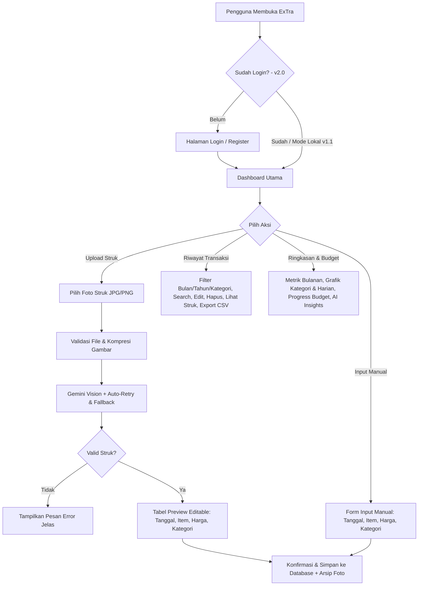
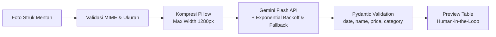
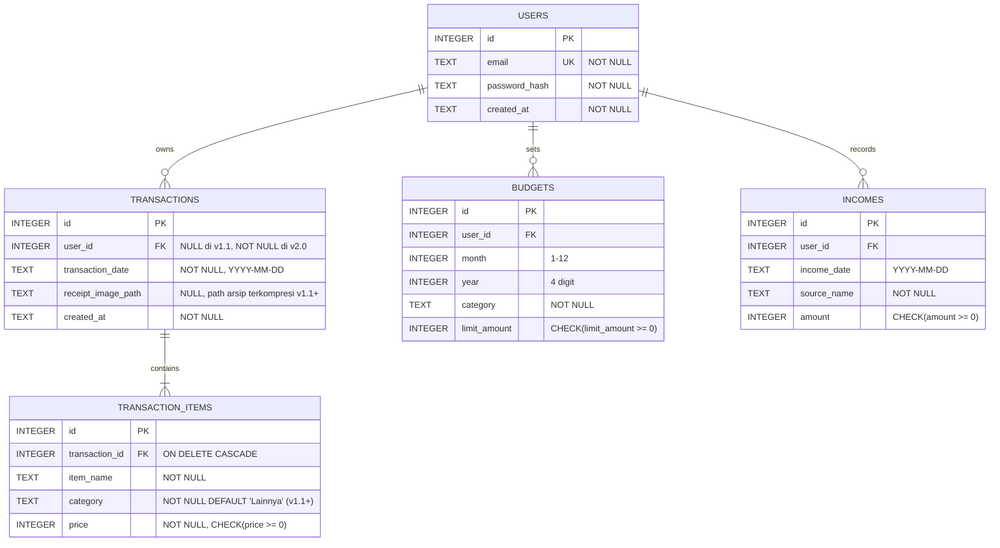

# Product Requirements Document (PRD): ExTra (Expense Tracker)

| Atribut Dokumen | Detail |
| :--- | :--- |
| **Nama Produk** | ExTra (Expense Tracker) |
| **Versi Dokumen** | 2.0 (Expansion & Production Roadmap Specification) |
| **Baseline Rilis** | v1.0.0 (MVP Selesai & Terverifikasi) |
| **Tipe Aplikasi** | AI-Powered Full-Stack Web Application |
| **Tanggal Pembaruan** | 25 November 2026 |
| **Status** | Aktif — Siap Masuk Gelombang 1 (v1.0.1 & v1.1) |
| **Tujuan Dokumen** | Pedoman tunggal (*Single Source of Truth*) arsitektur, kontrak data, batasan ruang lingkup, dan peta jalan pengembangan bertahap pasca-MVP |

---

## 1. Product Overview

**ExTra (Expense Tracker)** adalah aplikasi pencatatan dan pemantauan keuangan pribadi berbasis web yang memanfaatkan **Multimodal AI (Vision)** untuk mengotomatisasi konversi foto struk belanja fisik menjadi catatan transaksi digital terstruktur.

Setelah **MVP v1.0.0** berhasil dibangun dan diverifikasi, dokumen ini memperluas spesifikasi produk menuju aplikasi produksi yang lebih tangguh, nyaman digunakan di perangkat mobile, dan mendukung skala multi-pengguna melalui tiga gelombang pengembangan:
* **Baseline v1.0.0 (Selesai):** Upload foto struk, ekstraksi AI (tanggal, nama barang, harga), validasi Pydantic dua tahap, tabel *preview* interaktif (*human-in-the-loop*), riwayat transaksi, dan ringkasan bulanan deterministik dengan SQLite + Vanilla Web UI.
* **Gelombang 1 — AI Hardening (v1.0.1) & Fitur Produktivitas (v1.1):** Kompresi gambar pra-kirim, mekanisme *auto-retry* & *fallback model*, input pengeluaran manual tanpa struk, kategorisasi pengeluaran otomatis dengan koreksi manual, arsip foto struk, serta ekspor laporan ke CSV/Excel.
* **Gelombang 2 — Modernisasi Frontend (v1.5):** Migrasi antarmuka dari Vanilla HTML/CSS/JS ke **React + Vite + Tailwind CSS** untuk pengalaman pengguna yang lebih responsif dan modern.
* **Gelombang 3 — Deployment & Ekspansi Produk (v1.2 – v2.0):** Containerization dengan Docker, CI/CD dasar, autentikasi multi-user, migrasi database ke PostgreSQL, pencatatan pemasukan & anggaran (*budgeting*), serta modul rekomendasi finansial berbasis AI yang terpisah dari alur ekstraksi.

---

## 2. Problem Statement

* **Beban Pencatatan Manual & Transaksi Non-Struk:** Tidak semua pengeluaran memiliki struk fisik (seperti parkir, transportasi, atau jajan tunai), sementara pengeluaran berstruk membutuhkan otomatisasi OCR/Vision agar pengguna tidak lelah mengetik item satu per satu.
* **Ketahanan Layanan AI di Dunia Nyata:** Ukuran foto kamera ponsel yang besar (3–5 MB) memperlambat proses unggah dan memperbesar risiko *timeout* atau error sementara (`429`/`503`) dari API eksternal.
* **Kebutuhan Evaluasi Kategori & Anggaran:** Pengguna membutuhkan pengelompokan kategori belanja, batas anggaran bulanan, serta akses lintas perangkat (terutama ponsel) tanpa kehilangan kendali verifikasi data (*human-in-the-loop*).
* **Risiko Halusinasi Angka oleh LLM:** Penyerahan kalkulasi total pengeluaran, sisa anggaran, maupun agregasi statistik langsung kepada LLM berisiko menghasilkan angka keliru.

**Solusi ExTra:** Mempertahankan pemisahan tegas antara AI (untuk ekstraksi terstruktur dan narasi wawasan berbasis data matang) dan backend deterministik (untuk seluruh perhitungan matematika keuangan), sambil meningkatkan pengalaman pengguna secara bertahap.

---

## 3. Product Goals & Objectives

| Fase | Objektif Utama | Indikator Keberhasilan |
| :--- | :--- | :--- |
| **v1.0.0 (Baseline)** | Membuktikan alur ekstraksi struk berbasis Gemini Vision + *human-in-the-loop* + kalkulasi deterministik. | **Tercapai:** Seluruh AC-01 s/d AC-06 lulus dan ter-push ke GitHub. |
| **Gelombang 1 (v1.0.1 – v1.1)** | Meningkatkan ketahanan panggilan AI terhadap error sementara serta melengkapi alur pencatatan harian. | Kompresi gambar memangkas ukuran upload > 50%; *auto-retry* menangani error sementara `429`/`503`; mendukung input manual, kategori, arsip struk, dan ekspor CSV. |
| **Gelombang 2 (v1.5)** | Menghadirkan antarmuka modern yang cepat dan nyaman di layar ponsel maupun desktop. | Seluruh fitur v1.1 berjalan mulus di atas **React + Vite + Tailwind CSS** tanpa regresi kontrak API. |
| **Gelombang 3 (v1.2 – v2.0)** | Memungkinkan aplikasi di-deploy ke cloud dan digunakan banyak pengguna dengan isolasi data serta fitur budgeting. | Aplikasi berjalan dalam container Docker, mendukung login multi-user di PostgreSQL, serta menyajikan budgeting dan AI insights tanpa halusinasi angka. |

---

## 4. Target Users & User Personas

### Persona 1: Mahasiswa & Pekerja Muda (Pengguna Harian Mobile-First)
* **Profil:** Raka (20 tahun) dan Dina (25 tahun), mencatat pengeluaran harian baik dari struk minimarket maupun jajan tunai tanpa struk.
* **Tujuan:** Memotret struk langsung dari browser ponsel setelah belanja, memantau kategori pengeluaran terbesar, dan menjaga belanja bulanan tetap di bawah batas anggaran.
* **Pain Points:** Unggah foto kamera HP sering lambat jika tidak dikompresi, dan pencatatan jajan non-struk belum terakomodasi.

### Persona 2: Pengguna Multi-Perangkat & Evaluasi Keuangan Pribadi
* **Profil:** Pengguna aktif yang mengakses ExTra dari ponsel saat bepergian dan dari laptop saat akhir bulan untuk mengunduh laporan CSV/Excel serta meninjau pola konsumsi lintas bulan.
* **Tujuan:** Memiliki akun pribadi yang aman, data tersimpan permanen di cloud, serta ringkasan anggaran dan rekomendasi penghematan yang mudah dipahami.

---

## 5. User Stories

### Baseline v1.0.0 (Sudah Terimplementasi)
* **US-01 s/d US-09:** Unggah foto struk (JPG/JPEG/PNG), indikator loading, ekstraksi otomatis (`date`, `name`, `price`), tabel *preview* interaktif (*editable*), konfirmasi eksplisit sebelum simpan, riwayat transaksi (cari & filter bulan/tahun, edit, hapus), serta ringkasan bulanan + grafik batang.

### Gelombang 1 — AI Hardening & Produktivitas (v1.0.1 – v1.1)
| ID | Sebagai... | Saya ingin... | Agar... | Fase |
| :--- | :--- | :--- | :--- | :--- |
| **US-10** | Pengguna | Foto struk berukuran besar otomatis dikompresi dan sistem mencoba ulang otomatis saat API sibuk | Proses analisis lebih cepat dan tidak mudah gagal karena gangguan sementara | v1.0.1 |
| **US-11** | Pengguna | Menambahkan pengeluaran secara manual tanpa mengunggah foto struk | Transaksi tanpa struk fisik tetap tercatat dalam satu riwayat terpadu | v1.1 |
| **US-12** | Pengguna | Sistem otomatis menebak kategori tiap barang dan mengizinkan saya mengubahnya di tabel preview/edit | Saya dapat memantau pengeluaran berdasarkan kategori belanja | v1.1 |
| **US-13** | Pengguna | Mengunduh riwayat pengeluaran bulanan ke file CSV/Excel dan melihat kembali foto struk tersimpan | Saya bisa mengolah data di spreadsheet dan mengecek bukti fisik transaksi | v1.1 |

### Gelombang 2 — Modernisasi Frontend (v1.5)
| ID | Sebagai... | Saya ingin... | Agar... | Fase |
| :--- | :--- | :--- | :--- | :--- |
| **US-14** | Pengguna | Menggunakan antarmuka modern berbasis React & Tailwind CSS yang nyaman di layar HP | Navigasi, form edit, dan visualisasi grafik terasa cepat dan responsif | v1.5 |

### Gelombang 3 — Deployment, Multi-User & Analitik (v1.2 – v2.0)
| ID | Sebagai... | Saya ingin... | Agar... | Fase |
| :--- | :--- | :--- | :--- | :--- |
| **US-15** | Pengguna | Mendaftar, login, dan mengakses ExTra secara online melalui URL HTTPS | Data pengeluaran saya terisolasi aman dan bisa diakses dari mana saja | v1.2 / v2.0 |
| **US-16** | Pengguna | Mencatat pemasukan, mengatur anggaran bulanan per kategori, dan membaca ringkasan AI bulanan | Saya tahu sisa anggaran secara real-time dan mendapat saran penghematan yang relevan | v2.0 |

---

## 6. Functional Requirements

### A. Baseline v1.0.0 (Sudah Selesai)
* **FR-01 s/d FR-20:** Tetap berlaku penuh sebagai fondasi sistem (validasi file gambar, ekstraksi Gemini Vision, validasi Pydantic dua tahap, tabel preview editable, CRUD riwayat, filter periode, dan kalkulasi ringkasan bulanan deterministik).

### B. Gelombang 1 — AI Hardening (v1.0.1) & Produktivitas (v1.1)
* **FR-21 (Kompresi Gambar Pra-Kirim):** Sebelum dikirim ke Gemini API, backend mengompresi gambar beresolusi tinggi menggunakan `Pillow` (lebar maksimum `1280px`, menjaga rasio aspek, kualitas JPEG teroptimasi) tanpa mengurangi keterbacaan teks struk.
* **FR-22 (Auto-Retry & Model Fallback):** `ai_service.py` menerapkan mekanisme *retry* dengan *exponential backoff* (maksimal 3 percobaan) khusus untuk error sementara (`429 Rate Limit` dan `503 Service Unavailable`), serta mendukung variabel environment `GEMINI_FALLBACK_MODEL` apabila model utama tetap gagal.
* **FR-23 (Input Pengeluaran Manual):** Antarmuka menyediakan mode/form **Tambah Manual** untuk memasukkan tanggal, daftar barang (nama, harga, kategori), dan menyimpannya langsung melalui `POST /api/transactions` tanpa melewati proses AI.
* **FR-24 (Kategorisasi Pengeluaran):**
  * Setiap item memiliki atribut `category` yang mengacu pada daftar kategori standar: `Makanan & Minuman`, `Kebutuhan Pokok`, `Transportasi`, `Kesehatan & Perawatan`, `Tagihan & Utilitas`, `Hiburan & Belanja`, dan `Lainnya`.
  * Gemini API menyarankan `category` untuk setiap item saat ekstraksi struk; pengguna dapat mengubahnya di tabel *preview* maupun saat mengedit item di Riwayat.
  * Ringkasan bulanan menambahkan agregasi pengeluaran per kategori (`category_breakdown`).
* **FR-25 (Ekspor Laporan CSV):** Menyediakan endpoint `GET /api/transactions/export` (dengan filter opsional `month` dan `year`) yang menghasilkan file `.csv` siap unduh berisi kolom: Tanggal, Nama Barang, Kategori, dan Harga.
* **FR-26 (Arsip Foto Struk Opsional):** Saat menyimpan transaksi hasil ekstraksi struk, backend menyimpan versi terkompresi foto struk di direktori lokal terkelola (`uploads/receipts/`) dan menyimpan referensi path-nya di tabel `transactions` agar dapat dilihat kembali melalui endpoint aman.

### C. Gelombang 2 — Modernisasi Frontend (v1.5)
* **FR-27 (Migrasi UI ke React + Vite + Tailwind CSS):**
  * Membangun ulang lapisan frontend menggunakan **React**, **Vite**, dan **Tailwind CSS** di direktori `frontend-v2/` terlebih dahulu hingga seluruh fitur v1.1 teruji lengkap.
  * Menggunakan komponen UI modular, state management bersih, dan library grafik modern (misal Recharts atau Chart.js) yang tetap mengonsumsi data agregasi dari backend FastAPI.
  * Setelah stabil, hasil *production build* (`dist/`) disajikan langsung oleh FastAPI atau reverse proxy.

### D. Gelombang 3 — Deployment & Ekspansi Skala Penuh (v1.2 – v2.0)
* **FR-28 (Containerization & CI):** Menyediakan `Dockerfile`, `docker-compose.yml` (dengan *persistent volume* untuk database dan arsip gambar), serta GitHub Actions workflow untuk menjalankan `pytest` otomatis pada setiap *push*/*pull request*.
* **FR-29 (Autentikasi & Multi-User):** Menyediakan registrasi dan login pengguna (`POST /api/auth/register`, `POST /api/auth/login`, `POST /api/auth/logout`, `GET /api/auth/me`) menggunakan password ter-hash (`bcrypt`/`argon2`) dan token JWT/cookie aman. Seluruh query transaksi, ringkasan, dan arsip struk wajib terisolasi berdasarkan `user_id`.
* **FR-30 (Abstraksi Database & PostgreSQL):** Memisahkan lapisan akses data agar mendukung **SQLite** untuk pengembangan lokal dan **PostgreSQL** untuk deployment produksi melalui konfigurasi `DATABASE_URL`.
* **FR-31 (Pemasukan & Budgeting):**
  * Mendukung pencatatan pemasukan (*income*) terpisah dari pengeluaran agar pengguna dapat melihat arus kas bulanan (*total income*, *total expense*, *net balance*).
  * Pengguna dapat menetapkan batas anggaran bulanan per kategori (`budgets`) dan melihat persentase pemakaian serta indikator peringatan saat mendekati/melewati batas.
* **FR-32 (AI Financial Insights Terpisah):**
  * Menyediakan modul layanan terpisah (`insights_service.py`) untuk menghasilkan ringkasan analisis kebiasaan belanja bulanan dan saran penghematan.
  * **Aturan Ketat:** Input ke LLM **hanya** berupa ringkasan angka agregat yang sudah dihitung oleh backend Python/SQL (total per kategori, perbandingan bulan lalu, status anggaran)—LLM dilarang mengakses baris transaksi mentah secara bebas atau menghitung angka sendiri.

---

## 7. Non-Functional Requirements

| ID | Kategori | Kebutuhan Spesifik | Kriteria Pengukuran |
| :--- | :--- | :--- | :--- |
| **NFR-01** | **Usability** | Antarmuka responsif *mobile-first* dengan alur navigasi jelas dan umpan balik visual instan. | Seluruh alur utama dapat digunakan nyaman pada layar lebar 360px (mobile) hingga 1440px (desktop). |
| **NFR-02** | **Performance & Resilience** | Kompresi gambar otomatis menurunkan ukuran file unggahan; panggilan AI tahan terhadap gangguan sementara. | Waktu respons ekstraksi rata-rata < 8 detik; error sementara `429`/`503` ditangani otomatis hingga 3 kali percobaan. |
| **NFR-03** | **Security & Privacy** | Kredensial tersimpan di `.env`; password ter-hash; akses file arsip struk tervalidasi kepemilikan user; anti *path traversal*. | Zero secret di Git/frontend; pengguna A tidak pernah bisa mengakses data atau foto struk milik pengguna B. |
| **NFR-04** | **Data Integrity** | Validasi Pydantic berlapis dan constraint relasional aktif pada SQLite maupun PostgreSQL. | Tidak ada data korup, harga negatif, kategori di luar enum, atau *orphan record*. |
| **NFR-05** | **Maintainability** | Pemisahan tegas antara AI Extraction, AI Insights, Business Logic, Database Layer, dan Frontend. | Perubahan framework UI atau migrasi SQLite ke PostgreSQL tidak mengubah logika bisnis inti maupun prompt ekstraksi. |

---

## 8. Scope & Phasing Matrix

Untuk menjaga fokus pengerjaan dan mencegah perubahan serentak yang berisiko, fitur dibagi ke dalam fase yang terkunci:

| Fitur / Komponen | v1.0.0 (Selesai) | Gelombang 1 (v1.0.1 – v1.1) | Gelombang 2 (v1.5) | Gelombang 3 (v1.2 – v2.0) | Status / Catatan |
| :--- | :---: | :---: | :---: | :---: | :--- |
| Ekstraksi struk dasar (`date`, `name`, `price`) | ✅ | ✅ | ✅ | ✅ | Sudah aktif |
| Kompresi gambar + Auto-retry & Fallback Model | ❌ | ✅ | ✅ | ✅ | Prioritas pertama |
| Input pengeluaran manual & Kategori item | ❌ | ✅ | ✅ | ✅ | Target v1.1 |
| Ekspor CSV & Arsip foto struk lokal | ❌ | ✅ | ✅ | ✅ | Target v1.1 |
| Migrasi Frontend ke React + Vite + Tailwind CSS | ❌ | ❌ | ✅ | ✅ | Dikerjakan setelah API v1.1 stabil |
| Docker & GitHub Actions CI | ❌ | ❌ | ❌ | ✅ | Target v1.2 |
| Login Multi-User, PostgreSQL, Budgeting & AI Insights | ❌ | ❌ | ❌ | ✅ | Target v2.0 |
| Ekstraksi nama toko, kasir, metode pembayaran | ❌ | ❌ | ❌ | ❌ | **Tetap di luar ruang lingkup** |
| Integrasi langsung rekening bank / e-wallet | ❌ | ❌ | ❌ | ❌ | **Tetap di luar ruang lingkup** |

---

## 9. User Flow (Target v1.1 – v2.0)



---

## 10. AI Workflow

ExTra memisahkan penggunaan AI menjadi **dua jalur terisolasi** agar tidak terjadi pencampuran antara tugas ekstraksi dokumen dan tugas analisis finansial:

### Jalur 1: Multimodal Receipt Extraction (v1.0.1 – v1.1)

* **Input:** Gambar struk terkompresi (`bytes` + `image/jpeg` atau `image/png`).
* **Output JSON:** `is_receipt`, `date` (`YYYY-MM-DD` atau `null`), daftar `items` berisi `name`, `price` (integer), dan `category` (dari daftar kategori tetap), serta `error_reason`.
* **Larangan:** Tetap dilarang mengekstrak nama toko/alamat/metode bayar, dilarang mengarang item/tanggal, dan dilarang menulis langsung ke database.

### Jalur 2: AI Financial Insights (v2.0 — Terpisah)
* **Input:** Hanya payload statistik teragregasi hasil kalkulasi backend Python/SQL (contoh: total pengeluaran bulan ini vs bulan lalu, persentase pemakaian budget per kategori, 3 kategori terbesar).
* **Output:** Ringkasan naratif singkat dalam Bahasa Indonesia yang menyoroti tren pengeluaran dan saran penghematan praktis.
* **Larangan:** LLM **tidak pernah** melakukan penjumlahan transaksi mentah; seluruh angka yang dirujuk berasal dari hasil perhitungan deterministik backend.

---

## 11. System Architecture

### Evolution of Technology Stack
* **Backend:** Python 3.10+, FastAPI, Uvicorn, Pydantic v2, `Pillow` (kompresi gambar), `google-genai` (Gemini SDK).
* **Database:** SQLite (v1.0 – v1.5) dengan lapisan abstraksi data yang siap bermigrasi ke PostgreSQL (`DATABASE_URL`) pada v2.0.
* **Frontend:**
  * *Gelombang 1 (v1.0.1 – v1.1):* HTML5, CSS3, Vanilla JS (dipertahankan sementara untuk memverifikasi API baru secara terisolasi).
  * *Gelombang 2 & 3 (v1.5 – v2.0):* **React + Vite + Tailwind CSS**.
* **Infrastructure & DevOps (v1.2+):** Docker, Docker Compose, GitHub Actions CI (`pytest` + frontend build check).

### Target Struktur Direktori
```text
ExTra/
├── .env                         # Lokal only (GEMINI_API_KEY, GEMINI_MODEL, GEMINI_FALLBACK_MODEL, DATABASE_URL, JWT_SECRET)
├── .env.example                 # Template konfigurasi environment
├── .gitignore                   # Mengabaikan .env, venv/, *.db, uploads/, node_modules/, dist/
├── Dockerfile                   # Image produksi (Gelombang 3)
├── docker-compose.yml           # Orkestrasi container & persistent volume (Gelombang 3)
├── requirements.txt
├── PRD.md
├── AGENTS.md
├── README.md
├── uploads/                     # Penyimpanan arsip foto struk terkompresi (v1.1+, diabaikan Git)
├── backend/
│   ├── main.py
│   ├── config.py
│   ├── database.py
│   ├── schemas/
│   │   ├── receipt.py
│   │   ├── transaction.py
│   │   ├── summary.py
│   │   ├── auth.py              # (Gelombang 3)
│   │   └── budget.py            # (Gelombang 3)
│   ├── services/
│   │   ├── image_service.py     # Kompresi & validasi gambar dengan Pillow (v1.0.1)
│   │   ├── ai_service.py        # Gemini Vision + retry/backoff + fallback (v1.0.1)
│   │   ├── prompts.py           # Prompt ekstraksi & prompt insights terpisah
│   │   ├── transaction_service.py
│   │   ├── summary_service.py
│   │   ├── export_service.py    # Ekspor laporan CSV (v1.1)
│   │   ├── auth_service.py      # (Gelombang 3)
│   │   └── insights_service.py  # (Gelombang 3)
│   └── routers/
│       ├── receipts.py
│       ├── transactions.py
│       ├── summary.py
│       ├── auth.py              # (Gelombang 3)
│       └── budgets.py           # (Gelombang 3)
├── frontend/                    # UI Vanilla v1.0–v1.1 (dipertahankan sampai migrasi selesai)
├── frontend-v2/                 # Aplikasi React + Vite + Tailwind CSS (Gelombang 2)
└── tests/
```

---

## 12. Database Design & ERD

### Evolusi Skema Database
* **v1.0.0 (Aktif):** Tabel `transactions` (`id`, `transaction_date`, `created_at`) dan `transaction_items` (`id`, `transaction_id`, `item_name`, `price`).
* **v1.1 (Penambahan Kolom Backward-Compatible):**
  * Menambahkan `receipt_image_path TEXT NULL` pada `transactions`.
  * Menambahkan `category TEXT NOT NULL DEFAULT 'Lainnya'` pada `transaction_items`.
* **v2.0 (Skema Multi-User & Budgeting):**
  * Menambahkan tabel `users` (`id`, `email`, `password_hash`, `created_at`) dan foreign key `user_id` pada `transactions`.
  * Menambahkan tabel `budgets` (`id`, `user_id`, `month`, `year`, `category`, `limit_amount`) dan pencatatan pemasukan (`incomes`).



---

## 13. API Requirements

### Endpoint Baseline v1.0.0 (Sudah Aktif)
* `GET /health`
* `POST /api/receipts/extract`
* `POST /api/transactions`
* `GET /api/transactions`
* `PUT /api/items/{item_id}`
* `DELETE /api/items/{item_id}`
* `DELETE /api/transactions/{transaction_id}`
* `GET /api/summary/monthly`

### Tambahan Endpoint Gelombang 1 (v1.1)
| Method | Endpoint | Deskripsi |
| :--- | :--- | :--- |
| `POST` | `/api/receipts/extract` *(update)* | Mendukung kompresi otomatis, *retry/fallback*, dan mengembalikan `category` pada tiap item serta `temp_image_token` jika pengguna ingin mengarsipkan foto struk saat simpan. |
| `GET` | `/api/transactions` *(update)* | Menambahkan filter opsional `category` selain `month`, `year`, dan `search`. |
| `GET` | `/api/transactions/export` | Mengunduh data pengeluaran terfilter (`month`, `year`, `category`) dalam format `text/csv`. |
| `GET` | `/api/transactions/{transaction_id}/receipt` | Mengambil file gambar struk yang diarsipkan untuk transaksi tertentu (validasi kepemilikan & anti path traversal). |
| `GET` | `/api/summary/monthly` *(update)* | Menambahkan `category_breakdown` (`category`, `total`, `item_count`) di samping `daily_breakdown`. |

### Tambahan Endpoint Gelombang 3 (v2.0)
* `POST /api/auth/register`, `POST /api/auth/login`, `POST /api/auth/logout`, `GET /api/auth/me`
* `GET /api/budgets`, `PUT /api/budgets`
* `POST /api/incomes`, `GET /api/incomes`, `DELETE /api/incomes/{income_id}`
* `GET /api/insights/monthly`

---

## 14. Error Handling & Edge Cases

* **Semua Penanganan Error v1.0.0 Tetap Berlaku:** Validasi tipe & ukuran file (`400`, `413`), gambar non-struk (`422 NOT_A_RECEIPT`), struk buram (`422 UNREADABLE_RECEIPT`), tanggal tidak terbaca (`date: null` + `warnings`), dan format JSON rusak (`502 AI_PARSE_ERROR`).
* **Penanganan Tambahan v1.0.1 – v2.0:**
  * **Transient AI Error (`429` / `503`):** Sistem melakukan *retry* otomatis hingga 3 kali dengan jeda eksponensial (misal 1s, 2s, 4s) dan mencoba `GEMINI_FALLBACK_MODEL` sebelum mengembalikan `503 AI_SERVICE_UNAVAILABLE`.
  * **Kategori Tak Dikenal dari AI:** Jika AI mengembalikan string kategori di luar daftar yang diizinkan, validator Pydantic menormalisasinya otomatis menjadi `"Lainnya"` agar proses ekstraksi tidak gagal.
  * **Akses Arsip Gambar Tidak Sah:** Permintaan ke endpoint file struk dengan ID tidak ada atau milik user lain ditolak dengan `404`/`403` tanpa membocorkan struktur direktori server.

---

## 15. Acceptance Criteria (Expansion Milestones)

* **AC-07 (AI Resilience — v1.0.1):** Simulasi error `503`/`429` pada panggilan pertama/kedua berhasil pulih otomatis lewat *retry* atau *fallback model*; gambar berukuran besar dikompresi tanpa merusak validasi format.
* **AC-08 (Productivity Features — v1.1):** Pengguna dapat mencatat pengeluaran manual tanpa foto, melihat & mengubah kategori item, mengarsipkan/melihat kembali foto struk, serta mengunduh file `.csv` yang terbuka rapi di Excel/Sheets.
* **AC-09 (Frontend Modernization — v1.5):** Seluruh alur pengguna berjalan di aplikasi React + Vite + Tailwind CSS dengan dukungan tampilan mobile (360px) dan desktop tanpa error konsol.
* **AC-10 (Deployment & Multi-User — v1.2 & v2.0):** Aplikasi berjalan melalui `docker compose up`, isolasi data antar-user terverifikasi lewat tes API, dan fitur budgeting serta AI Insights berjalan dengan angka yang 100% konsisten dengan database.

---

## 16. Testing Strategy

* **Regression Guard:** Seluruh test suite `pytest` dari v1.0.0 (`test_schemas.py`, `test_database.py`, `test_summary.py`, `test_api.py`) wajib tetap lulus di setiap perubahan.
* **Unit & Integration Test Baru:**
  * Pengujian kompresi `Pillow` dan mekanisme *retry/fallback* pada `ai_service.py` menggunakan mock error `429`/`503`.
  * Pengujian ekspor CSV, filter kategori, dan migrasi kolom SQLite agar data lama v1.0 tetap terbaca aman.
  * Pengujian isolasi data antar-user (`user A` vs `user B`) dan validasi JWT pada Gelombang 3.
* **Frontend Verification (Gelombang 2):** Verifikasi `npm run build` bebas error TypeScript/linting serta uji manual end-to-end seluruh fitur di viewport desktop & mobile.

---

## 17. Development Roadmap (Post-MVP)

Pengembangan dilaksanakan dalam **3 Gelombang** yang dipecah menjadi milestone kecil:

| Gelombang | Milestone | Fokus & Deliverable |
| :--- | :--- | :--- |
| **Gelombang 1** | **M1.1 — AI Hardening (v1.0.1)** | Kompresi gambar `Pillow` (`image_service.py`), *auto-retry* exponential backoff, `GEMINI_FALLBACK_MODEL`, dan unit test ketahanan AI. |
| **Gelombang 1** | **M1.2 — Kategori & Input Manual (v1.1a)** | Penambahan kolom `category`, update prompt & skema Pydantic, breakdown kategori di summary, serta alur input manual di backend & UI sementara. |
| **Gelombang 1** | **M1.3 — Ekspor CSV & Arsip Struk (v1.1b)** | Endpoint ekspor `.csv`, penyimpanan arsip foto struk terkompresi (`uploads/receipts/`), dan tombol unduh/lihat struk. |
| **Gelombang 2** | **M2.1 — Setup & Core UI React (v1.5a)** | Inisialisasi `frontend-v2/` (React + Vite + Tailwind CSS), API client terpusat, serta halaman Upload/Preview & Input Manual. |
| **Gelombang 2** | **M2.2 — Riwayat, Summary & Cutover (v1.5b)** | Halaman Riwayat (filter kategori, ekspor CSV, lihat arsip struk), Dashboard Ringkasan + grafik modern, lalu integrasi build ke FastAPI. |
| **Gelombang 3** | **M3.1 — Docker & CI/CD (v1.2)** | Pembuatan `Dockerfile`, `docker-compose.yml` dengan persistent volume, dan GitHub Actions CI untuk `pytest` + build frontend. |
| **Gelombang 3** | **M3.2 — Auth & PostgreSQL (v2.0a)** | Tabel `users`, registrasi/login JWT, isolasi data per pengguna, serta dukungan `DATABASE_URL` PostgreSQL. |
| **Gelombang 3** | **M3.3 — Budgeting & AI Insights (v2.0b)** | Pencatatan pemasukan, pengaturan anggaran per kategori, dan modul `insights_service.py` berbasis ringkasan agregat backend. |